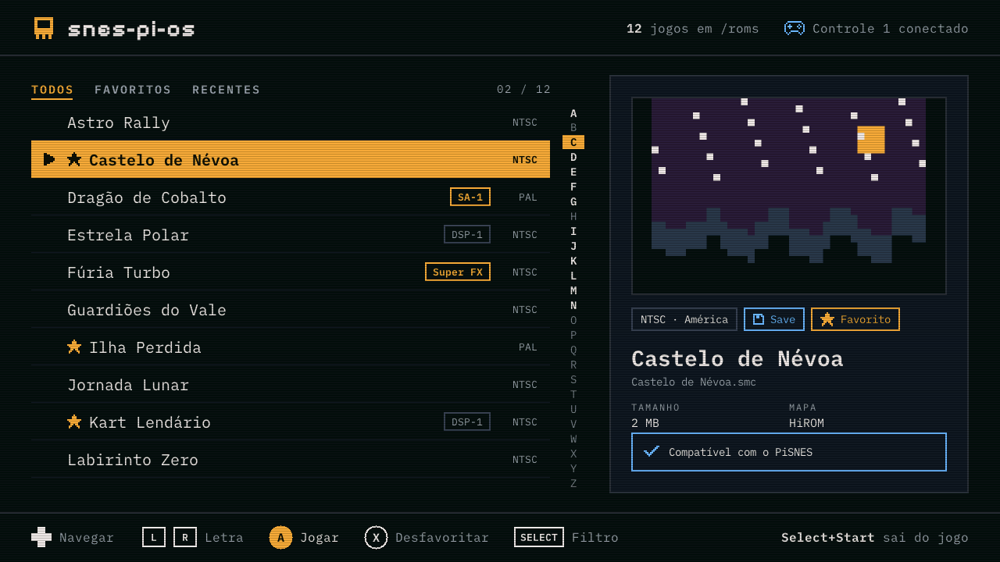
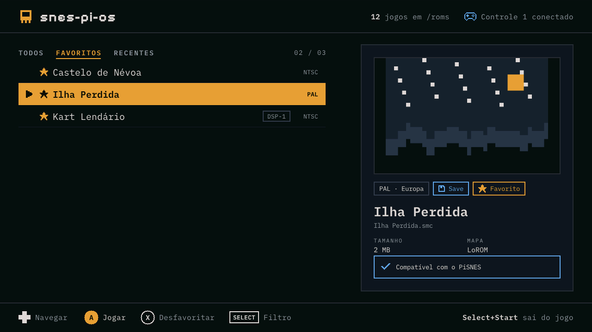
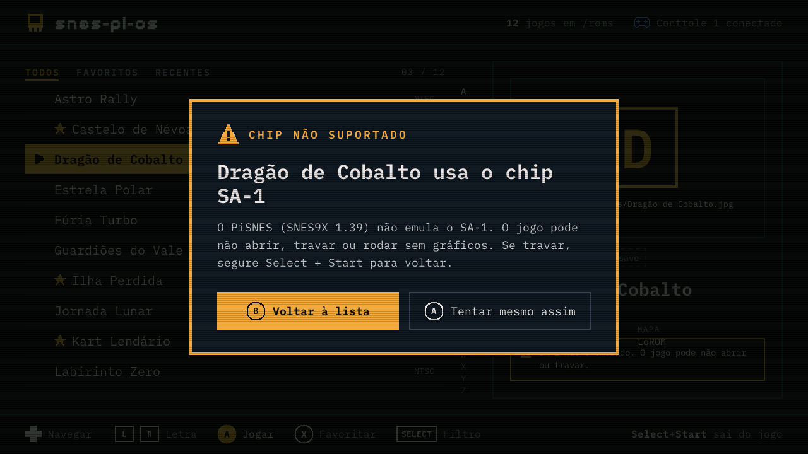
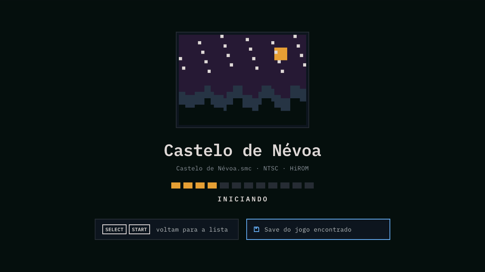
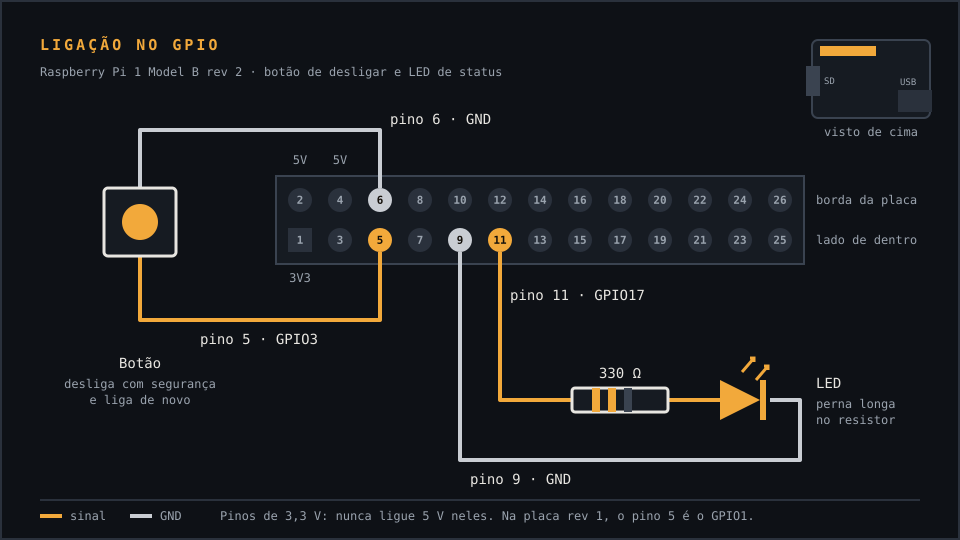

# snes-pi-os

Sistema Linux mínimo e dedicado que transforma um **Raspberry Pi 1** (Model B de 512 MB; BCM2835, ARM1176 de 700 MHz, com overclock para 900 MHz) num console de Super Nintendo: liga direto num menu de jogos, com capas, favoritos e saves automáticos.

Não é uma distro genérica: só o necessário para ligar, escolher o jogo e jogar, com boot curto e um sistema que aguenta ser desligado na tomada.

- **Para quem vai usar:** instruções, controles e perguntas frequentes em **https://snespi.geraldojunior.dev**
- **Download:** [Releases](https://github.com/geraldoantonio/snes-pi-os/releases) (imagem `.img.xz` para gravar no cartão SD)



<sub>Tela real do launcher, gerada com ROMs de teste (`make shots` em `launcher/`).</sub>

## Status

> **Em desenvolvimento (pré-lançamento).** Boot, menu e jogos já rodam num Pi 1 Model B de verdade; controles USB, saves e jogos com chips especiais ainda sem teste.

| Parte | Situação |
|---|---|
| Imagem do cartão (Buildroot) | Compila no CI e gera a `sdcard.img` com 3 partições; **liga no hardware** com tela de abertura |
| PiSNES (emulador) | **Roda no hardware** (Pi 1 Model B, 900 MHz): Mortal Kombat II, Aladdin, Donkey Kong Country |
| Launcher (`launcher/`) | **Roda no hardware** (HDMI 1080p, teclado USB), com música, capas e abertura dos jogos; controle USB (verificar) |
| Teste de boot no QEMU | No CI, a cada build: kernel, init, montagens e launcher no framebuffer |
| Modo rede (enviar jogos pela página web) | Especificado e desenhado; não implementado |

Detalhes e próximos passos em [docs/pendencias.md](docs/pendencias.md).

## Recursos

- Liga direto no menu (launcher próprio em C, desenhando no framebuffer) e volta a ele ao sair do jogo
- Capas dos jogos (`/roms/capas/<nome>.jpg|png`), favoritos e os 5 últimos jogados
- Aviso antes de abrir jogos com chips que o emulador não suporta (Super FX, SA-1, SDD-1, C4, SPC7110, S-RTC)
- Controle USB (Xbox 360 é o mais garantido) ou teclado; dois jogadores com dois controles
- Raiz somente leitura; só a partição de jogos e saves é gravada
- Menu do sistema (Start) para desligar ou reiniciar com segurança; botão de desligar e LED de status opcionais no GPIO
- Dois jogos de teste gratuitos na imagem, para validar logo após gravar o cartão

| Favoritos e recentes | Aviso de chip não suportado | Iniciando o jogo |
|---|---|---|
|  |  |  |

## Botão de desligar e LED de status (opcional)



| Peça | Pinos | O que faz |
|---|---|---|
| Botão (normalmente aberto) | 5 (GPIO3) e 6 (GND) | Fecha o jogo gravando o save e desliga; com o aparelho desligado, liga de novo (verificar) |
| LED + resistor de 330 Ω | 11 (GPIO17) e 9 (GND) | Pisca no boot, aceso no menu, pisca rápido ao desligar; **apagado = pode tirar da tomada** |

A imagem já vem configurada (overlays `gpio-shutdown` e `gpio-led` no `config.txt`). Sem botão, o mesmo desligamento fica no menu do sistema: **Start** (ou Espaço) › **Desligar**. Ainda sem teste no hardware (verificar). Detalhes em [docs/hardware-e-limites.md](docs/hardware-e-limites.md).

## Visão geral técnica

| Camada | Escolha |
|---|---|
| Hardware alvo | Raspberry Pi 1 Model B rev 2 (ARMv6, hard-float); DTBs do Model B rev 1 e B+ também |
| Sistema base | [Buildroot](https://buildroot.org/) **2025.02.19 LTS** (última com `rpi-userland`), BusyBox init, `mdev` |
| Emulador | [PiSNES](https://github.com/RetroPie/pisnes) (SNES9X 1.39), com patches de cross-compile |
| Frontend | `snespi-launcher` (C, framebuffer RGB565 1280×720, evdev, `stb_truetype`/`stb_image`) |
| Vídeo | GLES2/dispmanx do firmware legado (`rpi-userland`); saída principal HDMI |
| Áudio | ALSA (`snd_bcm2835`) |
| ROMs e saves | 3ª partição FAT32 (`ROMS`) montada em `/roms`, gravada com 512 MB e ampliada até o fim do cartão no primeiro boot (`S01roms`); `HOME=/roms` |
| Build | GitHub Actions em contêiner Debian 12, com cache; Releases nas tags `v*` |
| Página | `site/`, Cloudflare Workers (só arquivos estáticos), em `snespi.geraldojunior.dev` |

## Desenvolvimento

### Imagem

O build roda no GitHub Actions (workflow `build`): manual pelo botão "Run workflow" ou ao criar uma tag `v*`, que também publica a Release. Localmente, com Docker:

```sh
docker run --rm -e HOST_UID=$(id -u) -v "$PWD":/src:ro -v snespi-work:/work \
  debian:12 sh /src/scripts/ci-container.sh
```

Detalhes em [docs/buildroot.md](docs/buildroot.md).

### Launcher

Roda no computador para desenvolver, sem o Pi:

```sh
cd launcher
make run      # janela SDL2 com ROMs de teste e um emulador falso (brew install sdl2)
make test     # confere a leitura dos cabeçalhos das ROMs de teste
make shots    # capturas de todas as telas em build/shots/
```

Detalhes em [launcher/README.md](launcher/README.md).

## Estrutura do repositório

```
snes-pi-os/
├── README.md, AGENTS.md, CLAUDE.md, LICENSE
├── docs/                      # arquitetura, hardware, buildroot, launcher, pendências
├── external/                  # árvore BR2_EXTERNAL do Buildroot
│   ├── configs/snespi_defconfig
│   ├── package/pisnes/        # emulador + patches
│   ├── package/snes-launcher/ # compila launcher/
│   ├── package/snespi-homebrew/ # jogos de teste (OpenSNES, MIT), baixados no build
│   └── board/snespi/          # config.txt, cmdline.txt, genimage, post-build/image, overlay/
├── launcher/                  # código C do launcher, fontes, stb, testes
├── scripts/                   # build, contêiner Debian 12, teste no QEMU
├── site/                      # página pública (Cloudflare)
└── .github/workflows/         # build (imagem, QEMU, Release) e site
```

## Documentação

- [docs/arquitetura.md](docs/arquitetura.md): como as peças se encaixam e por quê
- [docs/hardware-e-limites.md](docs/hardware-e-limites.md): o Pi 1, desempenho e compatibilidade de jogos
- [docs/buildroot.md](docs/buildroot.md): versão do Buildroot, pacotes, board, CI e primeiro boot
- [docs/launcher.md](docs/launcher.md): comportamento, design e modo rede
- [docs/pendencias.md](docs/pendencias.md): decisões, o que falta verificar e próximos passos
- [AGENTS.md](AGENTS.md): orientações para agentes de IA que trabalham no repositório

## Jogos e ROMs

Este repositório **não inclui ROMs**. Use apenas jogos que você tem o direito de usar.

A imagem traz dois jogos de teste gratuitos, exemplos do [OpenSNES](https://github.com/k0b3n4irb/opensnes) (licença MIT), baixados durante o build pelo pacote `snespi-homebrew`.

## Licenças

O código original deste repositório (launcher, pacotes e configurações do Buildroot, scripts, site) é distribuído sob a licença [MIT](LICENSE).

O PiSNES não faz parte deste repositório: é baixado no build e tem licença própria (derivado do SNES9X, de uso não comercial). Os patches em `external/package/pisnes/` seguem a licença do PiSNES. O launcher é um programa separado e não é linkado ao emulador. Bibliotecas e fontes de terceiros do launcher: `stb` (domínio público), IBM Plex Mono e Pixelify Sans (OFL), com licenças em `launcher/fonts/`.

Super Nintendo e Super NES são marcas da Nintendo. Este projeto não tem relação com a Nintendo.
