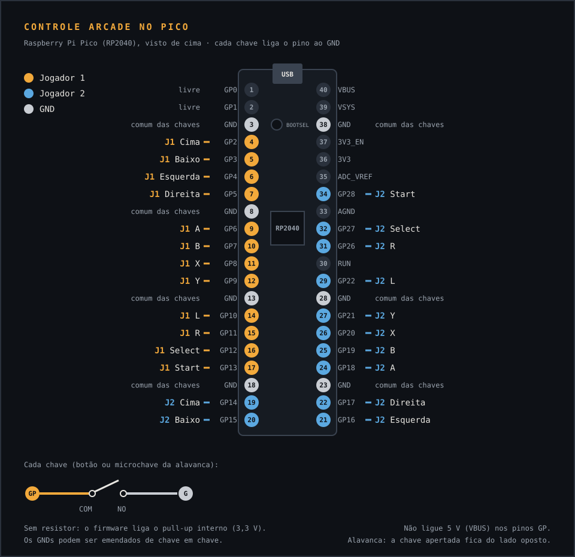

# Controle arcade com Raspberry Pi Pico

Um painel arcade (alavanca e botões) ligado a um **Raspberry Pi Pico (RP2040)**, que aparece no USB como joystick. O firmware fica em [`firmware/arcade/`](../firmware/arcade/) (C, pico-sdk 2.3.1 + TinyUSB).

> **Estado:** funciona no Pi (2026-11-20, versão `2p`): navega no launcher, no **Teste - Controles** cada botão dos dois jogadores acende no lugar certo, e Select + Start sai do jogo. Os testes foram com um fio ao GND; **falta montar com chaves de verdade (verificar)**.

## Como funciona

- O Pico imita um **controle USB genérico estilo SNES** (como o Knup KP-3124): eixos X e Y para a alavanca e botões com a numeração X = 0, A = 1, B = 2, Y = 3, L = 4, R = 5, Select = 8, Start = 9. É o que o launcher (`input_evdev.c`) e o `snes9x.cfg` do overlay já esperam, então **nada muda na imagem** e os controles e o teclado atuais continuam funcionando.
- Um Pico atende **dois jogadores**: o USB tem uma interface HID por jogador, e o Linux cria um joystick para cada uma (funciona no Pi, 2026-11-20). Os dois ocupam uma só porta USB do Pi; a outra fica livre para teclado ou pendrive.
- A coleção HID usa o tipo *Joystick*, não *Gamepad*: com *Gamepad* o Linux numeraria os botões pela convenção do Xbox (`BTN_SOUTH`...), e o jogo precisaria de outro `snes9x.cfg`.
- As chaves são lidas a cada 1 ms e o USB é consultado a cada 1 ms. O aperto vale na primeira leitura; depois a entrada fica travada por 5 ms para ignorar o repique da chave.
- Direções opostas ao mesmo tempo (painel com botões no lugar da alavanca) viram centro.
- O LED do Pico acende quando o computador reconhece o controle.

## Material

- 1 Raspberry Pi Pico (ou Pico H; o Pico W deve servir, sem o LED **(verificar)**) e cabo micro-USB **de dados**.
- Por jogador: 1 alavanca arcade de 4 microchaves e 8 botões (A, B, X, Y, L, R, Select, Start).
- Fios; de preferência conectores de 2,8 mm ou 4,8 mm, conforme os botões.

Não precisa de resistores: o firmware liga o pull-up interno de cada pino.

## Ligação

Cada chave tem dois terminais: um vai ao pino do Pico e o outro ao **GND**. Nas microchaves, use os terminais **COM** e **NO**. Os GNDs podem ser emendados em corrente, de chave em chave, até qualquer pino GND do Pico (3, 8, 13, 18, 23, 28, 38).



| Entrada | Jogador 1 | Pino da placa | Jogador 2 | Pino da placa |
|---|---|---|---|---|
| Cima | GP2 | 4 | GP14 | 19 |
| Baixo | GP3 | 5 | GP15 | 20 |
| Esquerda | GP4 | 6 | GP16 | 21 |
| Direita | GP5 | 7 | GP17 | 22 |
| A | GP6 | 9 | GP18 | 24 |
| B | GP7 | 10 | GP19 | 25 |
| X | GP8 | 11 | GP20 | 26 |
| Y | GP9 | 12 | GP21 | 27 |
| L | GP10 | 14 | GP22 | 29 |
| R | GP11 | 15 | GP26 | 31 |
| Select | GP12 | 16 | GP27 | 32 |
| Start | GP13 | 17 | GP28 | 34 |

GP0 e GP1 (pinos 1 e 2) ficam livres. Para mudar os pinos, edite `firmware/arcade/src/pins.h`.

**Alavanca:** a microchave apertada fica do lado **oposto** ao movimento (empurrar para cima aperta a chave de baixo). Se uma direção sair trocada, troque os dois fios.

**Só um jogador:** deixe os pinos do jogador 2 soltos, ou grave a versão `1p` (ver abaixo).

## Gravar o firmware

1. Compile (precisa de Docker; a primeira vez baixa o pico-sdk):
   ```sh
   cd firmware/arcade
   make uf2        # gera build/snespi-arcade-1p-v<versão>.uf2 e build/snespi-arcade-2p-v<versão>.uf2
   ```
   Para só usar, baixe os arquivos prontos na Release "Controle arcade" da [página de versões](https://github.com/geraldoantonio/snes-pi-os/releases). O CI também os compila a cada push (artefato `snespi-arcade-<sha>`).
2. Segure o botão **BOOTSEL** do Pico e ligue o cabo USB no computador. Aparece a unidade `RPI-RP2`.
3. Copie o `.uf2` para a unidade. O Pico reinicia sozinho já como controle.

Para regravar com o painel fechado: ligue o cabo segurando **Select + Start do jogador 1**; o Pico entra no modo BOOTSEL.

| Arquivo | Uso |
|---|---|
| `snespi-arcade-2p-v<versão>.uf2` | painel de dois jogadores (ou de um, com os pinos do jogador 2 soltos) |
| `snespi-arcade-1p-v<versão>.uf2` | painel de um jogador que vai ser usado junto com outro controle USB |

Testadores de controle no navegador podem mostrar só um dos dois jogadores (visto no Chrome do macOS); as duas interfaces respondem mesmo assim.

O PiSNES só usa os **dois primeiros** joysticks. Com a versão `2p`, o Pico já ocupa os dois, e um controle USB extra fica de fora do jogo; para arcade + controle USB, use a `1p`. Quem vira jogador 1 depende da ordem em que o Linux encontra os aparelhos **(verificar no Pi)**.

## Versões do firmware

O firmware tem versão própria, separada da versão da imagem: fica em [`firmware/arcade/VERSION`](../firmware/arcade/VERSION) e vai para o nome do `.uf2` e para o campo `bcdDevice` do USB (1.2.3 vira `0x0123`), então dá para saber qual versão está gravada sem abrir o painel:

```sh
lsusb -v -d 1209:0001 | grep bcdDevice     # Linux: "bcdDevice 1.00" = 1.0.0
```

No macOS: Informações do Sistema › USB › Controle Arcade › Versão.

Regra (`MAIOR.MENOR.CORREÇÃO`, um dígito cada, limite do `bcdDevice`):

- **MAIOR:** muda o que o sistema enxerga ou a fiação (relatório HID, numeração dos botões, pinos padrão). Pode exigir mexer no `snes9x.cfg`, no launcher ou no painel.
- **MENOR:** recurso novo que não quebra painéis já montados.
- **CORREÇÃO:** só correções.

Para lançar uma versão: edite o `VERSION`, acrescente uma linha na tabela abaixo, faça o commit e, com o merge na `main`, crie a tag `arcade-v<versão>` (ex.: `arcade-v1.0.0`). O CI confere se a tag bate com o `VERSION` e publica a Release "Controle arcade v<versão>" com os `.uf2`. Ela é separada das Releases da imagem (`v*`): mudar o firmware não gera versão nova do sistema.

| Versão | Data | O que mudou |
|---|---|---|
| 1.0.0 | 2026-11-20 | Primeira versão: dois jogadores num Pico, layout do controle estilo SNES, BOOTSEL com Select + Start ao ligar. Testada no Pi. |

## No snes-pi-os

Igual ao controle estilo SNES:

- **Menu:** A confirma, B volta, X favorita, Select troca o filtro, Start abre o menu do sistema.
- **Jogo:** Select + Start (jogador 1) sai e grava o save; Select + R grava o estado; Select + L carrega.

## Conferir no computador

No Linux, com o Pico ligado:

```sh
lsusb -d 1209:0001              # "snes-pi-os Controle Arcade"
jstest /dev/input/js0           # 2 eixos e 10 botões; js1 é o jogador 2
```

No Pi, o **Teste - Controles** do menu mostra os dois jogadores.

O firmware usa o identificador USB `1209:0001`, o PID de teste do [pid.codes](https://pid.codes/1209/0001/): serve para uso próprio, não para vender o painel.

## Teste no Linux sem o Pi

```sh
make -C firmware/arcade linux-test   # Docker + QEMU, uns 2 minutos
```

Sobe um kernel Linux (Debian 12) no QEMU e entrega a ele, pelo `uhid`, o mesmo descritor HID do firmware. O teste confere o joystick criado (10 botões de `BTN_TRIGGER` a `BTN_BASE4`, eixos X e Y de 0 a 255) e, para cada entrada, o código que o launcher espera e o número de botão do `snes9x.cfg`. Passou em 2026-11-20.

Não cobre o USB (o QEMU não recebe o Pico de verdade) nem o kernel da imagem do Pi; para isso, só o teste no hardware.

## Lista de verificação (hardware)

- [x] Cada pino dá a direção ou o botão certo, no jogador certo (macOS, lendo os relatórios HID, 2026-11-20).
- [x] No Pi, o Pico aparece como dois controles e os dois jogadores respondem no Teste - Controles (2026-11-20).
- [x] Launcher: navega com o Pico (2026-11-20).
- [x] Teste - Controles: cada botão acende no lugar certo, nos dois jogadores (2026-11-20).
- [x] Select + Start sai do jogo (2026-11-20).
- [ ] Select + R e Select + L gravam e carregam o estado.
- [ ] Sem toques duplos nem botão preso (repique); se houver, aumente `PAD_DEBOUNCE_MS` em `pad.h`.
- [ ] Select + Start ao ligar o cabo entra no BOOTSEL.
- [ ] O Pi 1 alimenta o Pico pela porta USB sem aviso de subtensão.
